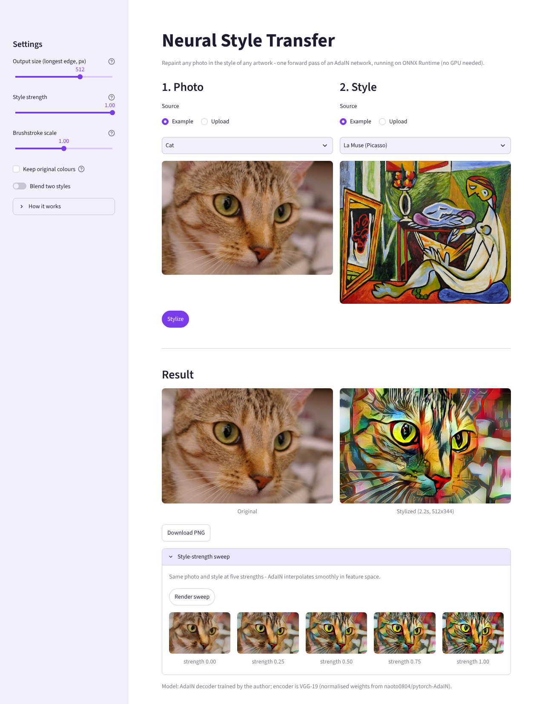
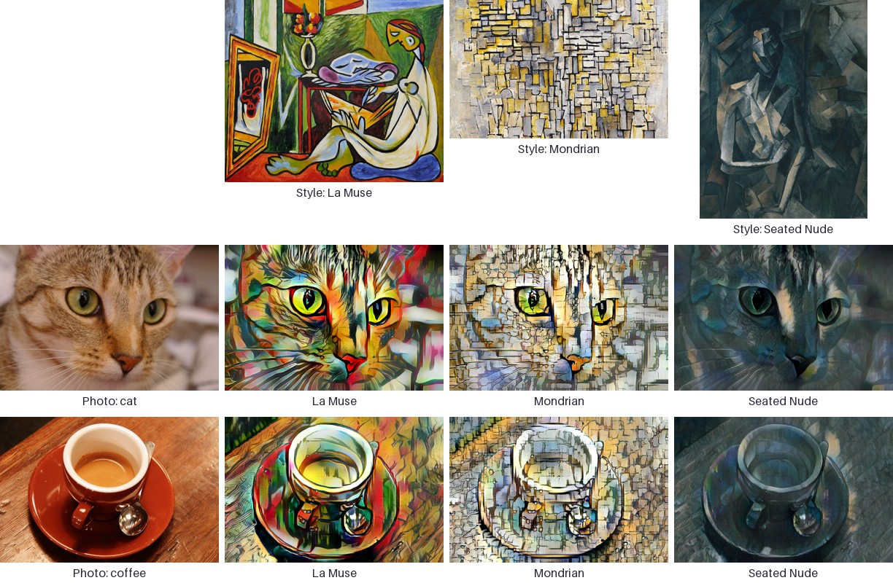
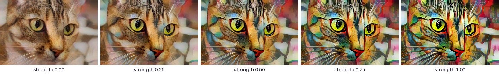
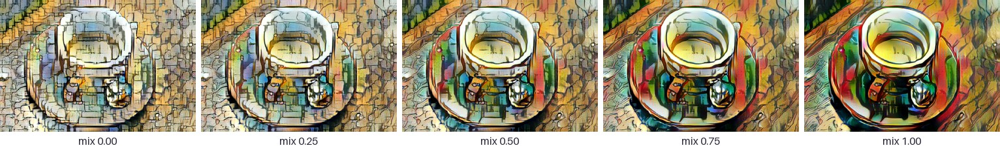
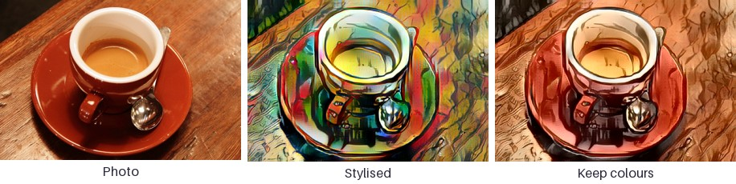
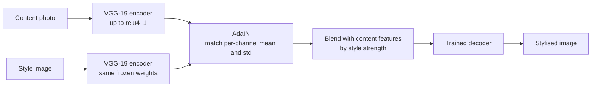

# Neural Style Transfer (AdaIN)

[](https://github.com/Rati-Akela/Neural_Style-_Transfer/actions/workflows/ci.yml)


Repaint any photo in the style of any artwork, **in a single forward pass**. This project implements *arbitrary* style transfer with **Adaptive Instance Normalization (AdaIN)** (Huang & Belongie, ICCV 2017): one trained network handles every style image, including ones it has never seen, in about two seconds on a plain CPU.

**Live demo:**  [neuralstyle-transfer.streamlit.app](https://neuralstyle-transfer.streamlit.app/)





## Features

- **Any photo, any style.** Pick example images or upload your own (JPG, PNG, WebP).
- **Style strength.** Slide from your original photo (0) to full stylisation (1). Because AdaIN works in feature space, the in-between values interpolate smoothly.
- **Brushstroke scale.** Resize the style before encoding for finer detail or bolder strokes.
- **Blend two styles.** Mix two artworks with a single slider.
- **Keep original colours.** Apply the style's texture while keeping the photo's colours (luminance-only transfer).
- **Download** the result as PNG, or render a five-step strength sweep.
- **Handles real-world photos.** EXIF rotation from phones is respected, transparency is flattened to white, grayscale and palette images work, and unreadable files give a clear error.

| Style strength | Style blending | Keep colours |
| --- | --- | --- |
|  |  |  |

## How it works



Both images are encoded by a frozen VGG-19. AdaIN then re-scales the photo's feature statistics to match the style's:

```
AdaIN(x, y) = σ(y) · (x − μ(x)) / σ(x) + μ(y)
```

where μ and σ are the per-channel mean and standard deviation. A decoder, the only part that is trained, turns the result back into an image. There is no per-image optimisation, which is what makes it real-time (the original optimisation-based method of Gatys et al. is orders of magnitude slower).

Training minimises a **content loss** (the decoded image should re-encode to the AdaIN features) plus a **style loss** (its feature mean/std at relu1_1 to relu4_1 should match the style image's). See [`adain/train.py`](adain/train.py).

### Engineering notes

- **Serving needs no PyTorch.** The encoder and decoder are exported to ONNX (`models/*.onnx`) and run with ONNX Runtime; AdaIN itself is a few lines of NumPy. The deployed app needs only four top-level requirements (Streamlit, ONNX Runtime, NumPy, Pillow) instead of multi-gigabyte PyTorch. A test checks that the ONNX output matches PyTorch to within 1e-4 on several image sizes (measured differences are about 5e-6), and CI runs the app tests in an environment with PyTorch uninstalled.
- **Low-memory inference.** ONNX Runtime's memory arena is disabled, cutting peak RAM by roughly 40% for under 10% extra latency, so it fits small free hosting tiers.
- **Dynamic image sizes.** The network downsamples 3×, so sizes are snapped to multiples of 8 and a 32 px minimum; otherwise the output size would not match the input.
- **Style features are cached**, so re-rendering with a different strength, blend or colour setting only repeats AdaIN and the decoder.

## Performance

Measured with [`scripts/benchmark.py`](scripts/benchmark.py), one fresh process per size, on a 2-core x86_64 CPU (no GPU), Python 3.13:

| Output size (longest edge) | Latency (median of 5) | Peak memory |
| --- | --- | --- |
| 256 px | 0.48 s | 164 MB |
| 384 px | 1.04 s | 214 MB |
| 512 px | 1.95 s | 291 MB |
| 640 px | 3.29 s | 377 MB |
| 768 px | 4.63 s | 489 MB |

## Quick start

```bash
git clone https://github.com/Rati-Akela/Neural_Style-_Transfer.git
cd Neural_Style-_Transfer
python -m venv .venv && source .venv/bin/activate   # Windows: .venv\Scripts\activate
pip install -r requirements.txt
streamlit run app.py
```

Use it from Python:

```python
from PIL import Image
from adain.engine import StyleTransfer

engine = StyleTransfer()
result = engine.stylize(
    Image.open("photo.jpg"), Image.open("artwork.jpg"), size=512, alpha=0.8, keep_colors=False
)
result.save("stylized.png")
```

## Training your own decoder

```bash
pip install -r requirements-train.txt
python -m adain.train --content-dir data/content --style-dir data/style --epochs 10
python -m adain.export onnx        # after copying your decoder to models/decoder_final.pth
```

`data/content` and `data/style` are folders of images; the paper uses MS-COCO photos and WikiArt paintings. Datasets are not included. Run `python -m adain.train --help` for all options. To rebuild the encoder file from the original VGG weights: `python -m adain.export trim vgg_normalised.pth`.

## Tests

```bash
pip install -r requirements-dev.txt
make lint test        # or: ruff check . && pytest
```

56 tests: AdaIN math (output statistics equal the style's, content-scale invariance, blending), image handling (EXIF, transparency, odd sizes), end-to-end inference with the real model, ONNX-vs-PyTorch parity, a real two-epoch training run, and headless UI tests of the Streamlit app.

## Deploy

**Streamlit Community Cloud (free):** push to GitHub, choose *Create app* at [share.streamlit.io](https://share.streamlit.io), set the main file to `app.py`, and under *Advanced settings* pick Python 3.12. No secrets are needed.

**Docker:** `docker compose up --build`, then open http://localhost:8501.

`NST_MAX_SIZE` (default `640`) sets the largest output size offered in the app. Memory grows roughly with the square of the size, so raise it only where you have the RAM.

## Project structure

```
app.py                Streamlit app
adain/
  model.py            PyTorch encoder/decoder + AdaIN (training, export)
  ops.py              NumPy AdaIN, blending, colour preservation, image helpers
  engine.py           ONNX Runtime inference engine with caching
  train.py, data.py   Training loop and dataset
  export.py           Trim encoder weights, export ONNX
models/               decoder_final.pth, encoder_relu4_1.pth, encoder.onnx, decoder.onnx
examples/             Example photos and style images
scripts/              Gallery generator, benchmark
tests/                56 tests
.github/workflows/    CI: lint + tests on Python 3.11-3.13, serving without torch, Docker build
```

## Limitations

- AdaIN matches global feature statistics, so it excels at colour and texture but can distort fine structure such as faces and text, and it is not photo-realistic style transfer.
- Large output sizes are slow on CPU and use more memory (see the table above).

## Credits

- **Method:** Xun Huang and Serge Belongie, [*Arbitrary Style Transfer in Real-time with Adaptive Instance Normalization*](https://arxiv.org/abs/1703.06868), ICCV 2017.
- **Encoder weights:** the normalised VGG-19 weights come from the [naoto0804/pytorch-AdaIN](https://github.com/naoto0804/pytorch-AdaIN) release (converted from the original authors' Torch release).
- **Example photos:** the cat and coffee photos are CC0 images from scikit-image's sample data.
- **Example styles:** reproductions of paintings by Picasso and Mondrian, included for demonstration. Check the copyright status of any artwork before redistributing commercially.

## Author

**Rati Kumari Akela**, Computer Science student interested in AI, machine learning and computer vision.

Licensed under the [MIT License](LICENSE).
